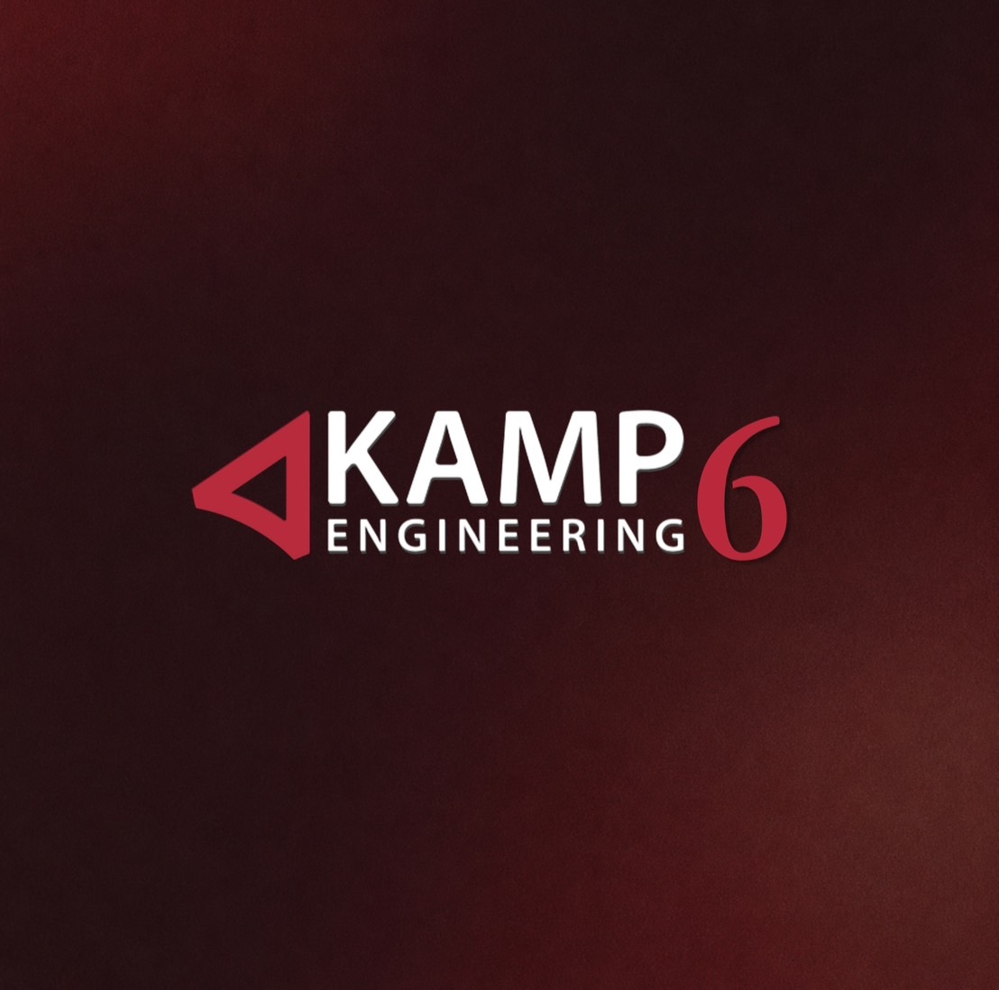
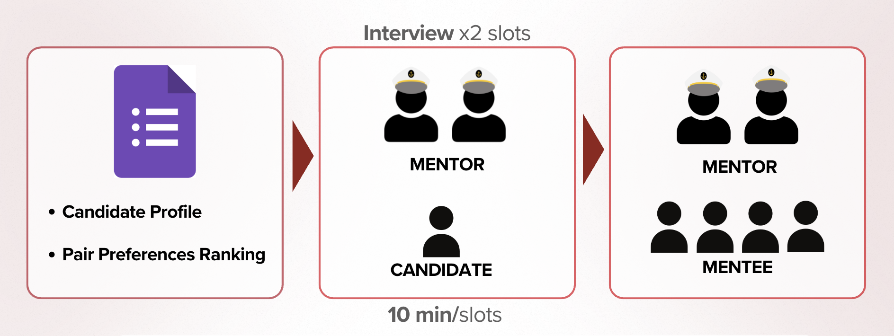

<a id="readme-top"></a>

<div align="center">
  

  <h1>🎓 KAMP Engineering 6</h1>
  <p><strong>Where experience inspires potential.</strong></p>
  <p>Kasetsart Alumni Mentorship Program for engineering students and alumni.</p>

  <p>
    <a href="#about-the-project"></a>
    <a href="#getting-started"></a>
    <a href="#usage"></a>
  </p>
</div>


<p align="center"><em>A public program site and private interview preparation space for 17 groups.</em></p>

## Table of Contents

1. [About The Project](#about-the-project)
   - [Built With](#built-with)
2. [Getting Started](#getting-started)
   - [Prerequisites](#prerequisites)
   - [Installation](#installation)
   - [Troubleshooting](#troubleshooting)
3. [Usage](#usage)
4. [Project Structure](#project-structure)
5. [Contributing](#contributing)
6. [License](#license)
7. [Contact](#contact)
8. [Acknowledgments](#acknowledgments)

## About The Project

KAMP Engineering 6 introduces the mentorship program, its activities, mentors, organizations, and application information. Interviewers use one of 17 private group links to see the candidates assigned to their group. Candidate details and group assignments are stored in PostgreSQL; the application reads them on the server.

The database uses `mentees_base` for applicant details, `mentee_pairs` for group assignments, and `group_links` for access tokens. A `mentees` view preserves the earlier data shape for previously deployed code without duplicating assignments.

<p align="right"><a href="#readme-top">back to top ↑</a></p>

### Built With

<p>
  
  
  
  
  
</p>

Deployed with Vercel.

<p align="right"><a href="#readme-top">back to top ↑</a></p>

## Getting Started

### Prerequisites

- Node.js 20.9 or newer and npm
- Git
- Access to the provisioned Neon PostgreSQL database and its `DATABASE_URL` to view candidate data

The repository does not include candidate records, group tokens, or a database migration. The database must already contain `mentees_base`, `mentee_pairs`, and `group_links` for the private interview pages to work.

### Installation

1. Clone the repository and install dependencies:

   ```bash
   git clone https://github.com/ucula/KAMP.git
   cd KAMP
   npm ci
   ```

2. Create `.env.local` in the project root with your database connection string:

   ```dotenv
   DATABASE_URL=postgresql://<user>:<password>@<host>/<database>?sslmode=require
   ```

   Keep `.env.local` private. For local development only, the app can instead read `.private/mentees.json` and `.private/group-links.json` when `DATABASE_URL` is absent. Those files are not included in the repository. Production requires `DATABASE_URL`.

3. Start the development server:

   ```bash
   npm run dev
   ```

4. Open [http://localhost:3000](http://localhost:3000). To deploy on Vercel, add `DATABASE_URL` to the project's environment variables.

### Troubleshooting

- **The public pages load but a group interview page fails:** Check that `DATABASE_URL` points to the provisioned database, or that both `.private` files are available for local development.
- **A group interview link returns 404:** Check the full token and confirm that it exists in `group_links`. Group tokens are 16 lowercase hexadecimal characters.
- **No candidates appear:** Check the group's assignments in `mentee_pairs` and its candidate records in `mentees_base`.
- **`DATABASE_URL is required in production`:** Add the variable to the deployment environment and redeploy.

<p align="right"><a href="#readme-top">back to top ↑</a></p>

## Usage

1. Visit `/home` for the program overview or `/application` for application information.
2. Share each `/g/<token>` link only with its intended interview group. The matching `/g/<token>/interview` page shows that group's assigned candidates.
3. For local testing, set `ENABLE_ALL_CANDIDATES_TEST_VIEW=true` and open `/interview?view=all`. This all-candidates view is disabled in production.

<p align="center">
  
</p>

Group links grant access to candidate profiles. Do not publish tokens or candidate data in issues, screenshots, or commits.

<p align="right"><a href="#readme-top">back to top ↑</a></p>

## Project Structure

| Path | Purpose |
| --- | --- |
| `app/` | Public and group-scoped routes |
| `components/` | Home, application, interview, and shared UI |
| `lib/mentees.ts` | Reads candidates and their group assignments |
| `lib/group-links.ts` | Resolves private group tokens |
| `public/kamp6/` | Program images and graphics |

<p align="right"><a href="#readme-top">back to top ↑</a></p>

## Contributing

Use a branch and open a pull request for changes. Run `npm run lint` and `npm run build` before submitting. Keep database credentials, group links, and candidate information out of commits.

<p align="right"><a href="#readme-top">back to top ↑</a></p>

## License

This repository does not currently include a license file. Contact the project owners before reusing its code or assets.

<p align="right"><a href="#readme-top">back to top ↑</a></p>

## Contact

Project repository: [ucula/KAMP](https://github.com/ucula/KAMP)

<p align="right"><a href="#readme-top">back to top ↑</a></p>

## Acknowledgments

Built for the Kasetsart Alumni Mentorship Program's Engineering 6 community.

<p align="right"><a href="#readme-top">back to top ↑</a></p>
